1. Jelaskan perbedaan console.log(), alert(), prompt(), dan textContent atau innerHTML dalam JavaScript!

console.log() digunakan untuk menampilkan informasi atau hasil proses JavaScript pada Console di browser. Fungsi ini biasanya digunakan untuk memeriksa hasil program saat proses pembuatan dan pengujian.

alert() digunakan untuk menampilkan pesan dalam bentuk kotak dialog kepada pengguna. Pesan ini harus ditutup terlebih dahulu sebelum pengguna dapat melanjutkan aktivitasnya.

prompt() digunakan untuk meminta pengguna memasukkan suatu nilai melalui kotak dialog. Nilai yang dimasukkan pengguna dapat digunakan sebagai data dalam program.

Sementara itu, textContent digunakan untuk menampilkan atau mengubah teks di dalam elemen HTML. Adapun innerHTML digunakan untuk membaca atau mengubah isi elemen HTML, termasuk elemen atau tag HTML di dalamnya.

2. Jelaskan perbedaan let dan const dalam JavaScript serta berikan contohnya secara sederhana!

let dan const merupakan kata kunci yang digunakan untuk membuat variabel dalam JavaScript. Perbedaannya terletak pada perubahan nilai variabel.

let digunakan ketika nilai variabel masih dapat diubah selama program berjalan. Contohnya, variabel yang menyimpan nilai mahasiswa dapat berubah ketika nilai tersebut diperbarui.

Sementara itu, const digunakan ketika variabel tidak akan diberi nilai baru setelah dideklarasikan. Contohnya, variabel yang menyimpan nama aplikasi yang tetap digunakan selama program berjalan.

Dengan demikian, let lebih sesuai untuk data yang nilainya dapat berubah, sedangkan const digunakan untuk variabel yang tidak perlu diberi nilai baru.

3. Jelaskan perbedaan operator == dan === dalam JavaScript!

Operator == digunakan untuk membandingkan dua nilai tanpa mengharuskan tipe datanya sama. JavaScript dapat melakukan konversi tipe data secara otomatis sebelum membandingkan kedua nilai tersebut.

Sementara itu, operator === digunakan untuk membandingkan nilai sekaligus tipe datanya. Kedua nilai harus memiliki nilai dan tipe data yang sama agar hasil perbandingannya benar.

Oleh karena itu, operator === umumnya lebih disarankan karena perbandingannya lebih ketat dan dapat mengurangi kesalahan akibat konversi tipe data otomatis.

4. Jelaskan fungsi percabangan if–else dan switch serta kapan keduanya digunakan!

Percabangan if–else digunakan untuk menjalankan perintah berdasarkan kondisi tertentu. Jika kondisi terpenuhi, program menjalankan perintah pertama. Jika kondisi tidak terpenuhi, program dapat menjalankan perintah lainnya.

Percabangan switch digunakan untuk memilih satu tindakan dari beberapa pilihan berdasarkan nilai suatu ekspresi. Setiap pilihan memiliki nilai yang dibandingkan dengan nilai ekspresi tersebut.

if–else lebih sesuai digunakan untuk kondisi yang melibatkan perbandingan, seperti menentukan kelulusan berdasarkan nilai. Sementara itu, switch lebih sesuai untuk beberapa pilihan tertentu, seperti menentukan nama hari berdasarkan angka yang dimasukkan pengguna.

5. Jelaskan apa yang dimaksud dengan parameter dan return dalam function JavaScript!

Parameter adalah variabel yang digunakan dalam sebuah function untuk menerima data atau nilai yang diberikan ketika function dipanggil. Parameter memungkinkan sebuah function digunakan untuk mengolah berbagai nilai tanpa harus membuat function baru untuk setiap nilai.

Sementara itu, return digunakan untuk mengembalikan hasil dari proses yang dilakukan oleh function kepada bagian program yang memanggilnya. Hasil tersebut dapat disimpan dalam variabel atau digunakan dalam proses perhitungan lainnya.

Dengan adanya parameter dan return, function dapat dibuat lebih fleksibel, dapat digunakan kembali, dan membantu membuat program menjadi lebih terstruktur.

6. Jelaskan bagaimana document.getElementById() digunakan untuk memilih elemen HTML!

document.getElementById() merupakan metode JavaScript yang digunakan untuk memilih elemen HTML berdasarkan atribut id yang dimilikinya. Setiap elemen yang ingin dipilih harus memiliki id yang sesuai dengan nama yang dicari.

Setelah elemen ditemukan, JavaScript dapat mengakses atau mengubah isi elemen tersebut, mengatur tampilannya, maupun menggunakan nilainya dalam proses program.

Metode ini sering digunakan dalam manipulasi HTML, misalnya untuk menampilkan hasil perhitungan, mengubah teks pada halaman, dan mengambil nilai yang dimasukkan pengguna melalui formulir.

7. Buatlah script untuk melakukan validasi form agar nama tidak boleh kosong dan nilai harus berada di antara 0–100!

Validasi form merupakan proses pemeriksaan data yang dimasukkan pengguna sebelum data tersebut diproses lebih lanjut. Pada soal ini, validasi dilakukan dengan memastikan bahwa kolom nama telah diisi dan nilai yang dimasukkan berada dalam rentang 0 sampai 100.

Jika kolom nama kosong, sistem akan menampilkan pesan bahwa nama wajib diisi. Jika nilai kurang dari 0 atau lebih dari 100, sistem akan menampilkan pesan bahwa nilai tidak valid. Apabila kedua persyaratan terpenuhi, data dapat diterima dan diproses lebih lanjut.

Validasi ini penting untuk mencegah data kosong atau nilai di luar ketentuan masuk ke dalam sistem. Selain itu, validasi membantu meningkatkan ketepatan data dan memberikan informasi kepada pengguna apabila terjadi kesalahan pengisian.

## HTML LATIHAN 1-MINI PROJECT

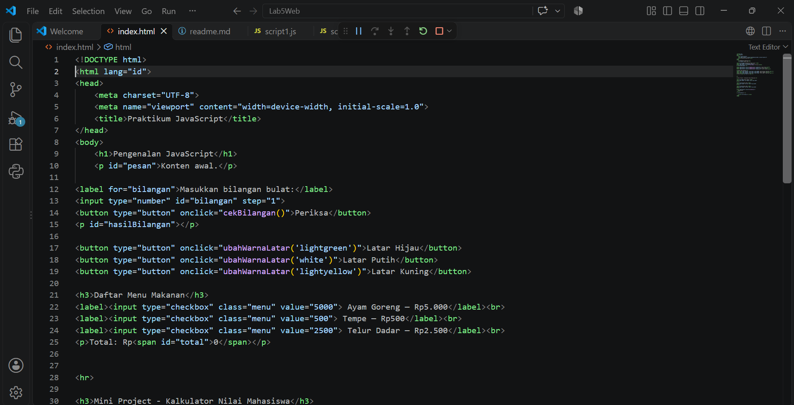
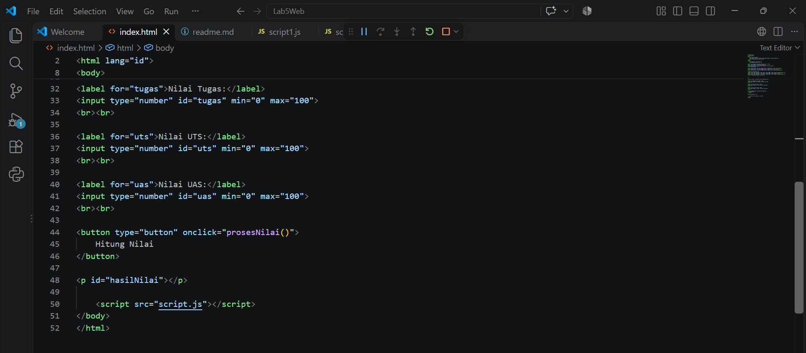

# JS LATIHAN 1-MINI PROJECT

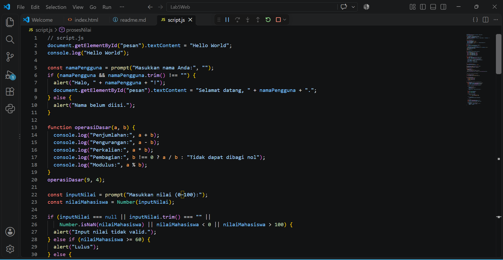
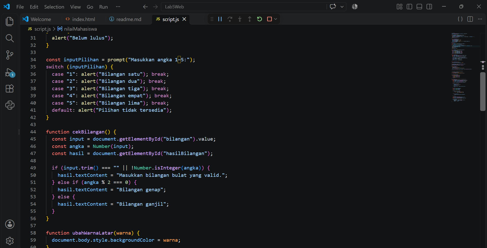
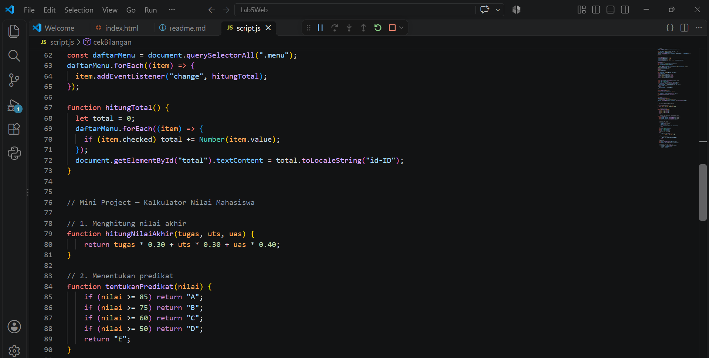
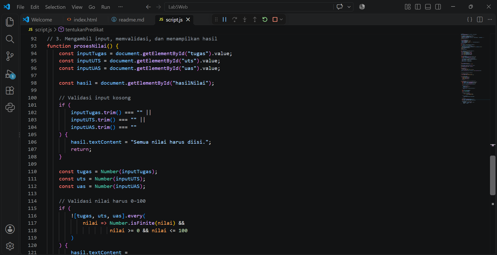
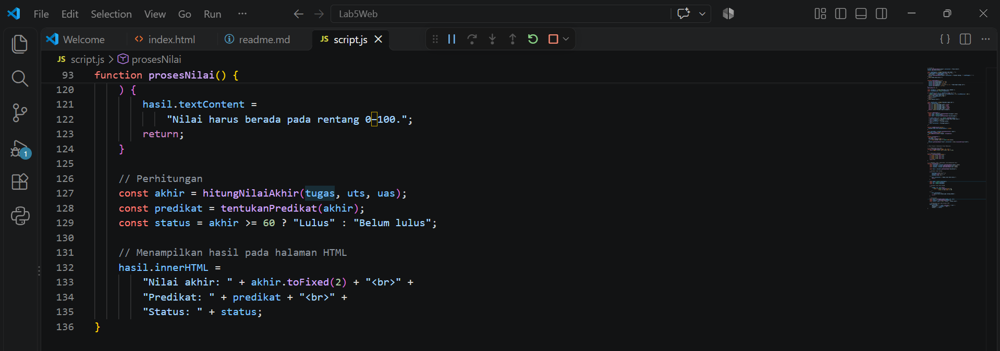

## WEB LATIHAN 1 - MINI PROJECT

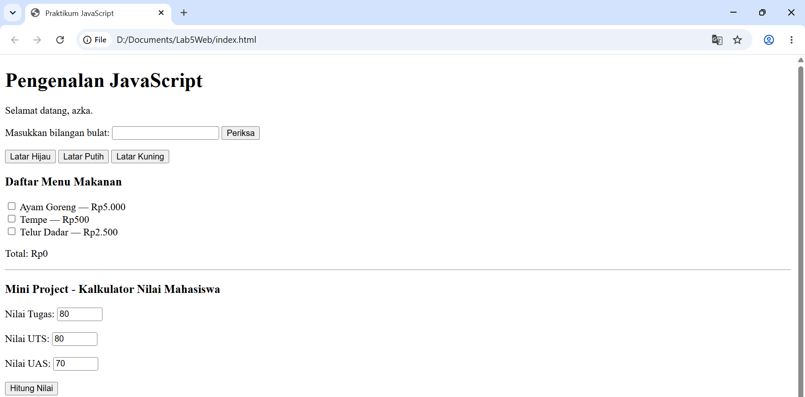
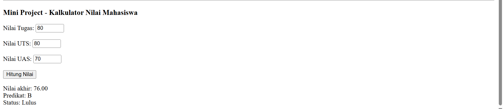

## EKSPERIMEN MANDIRI ##

## UBAH LATIHAN 3

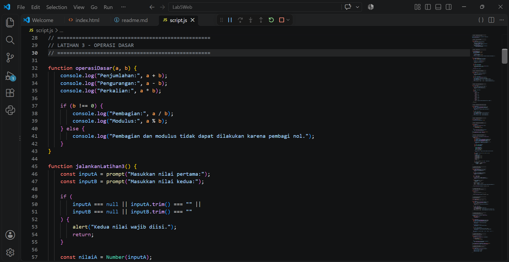
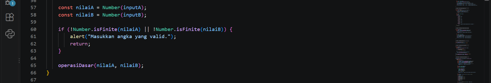

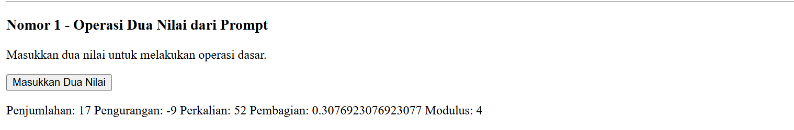

## TABEL PERKALIAN

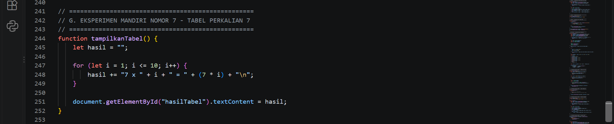
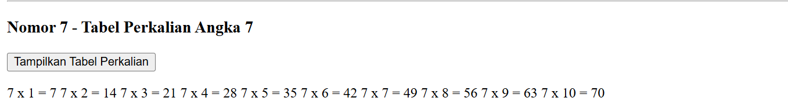

## CEK GENAP

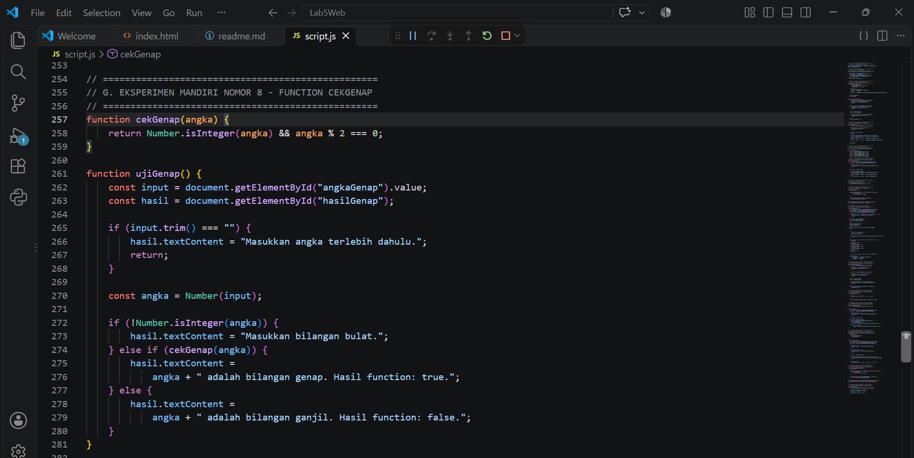
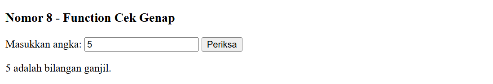

## VALIDASI FORM

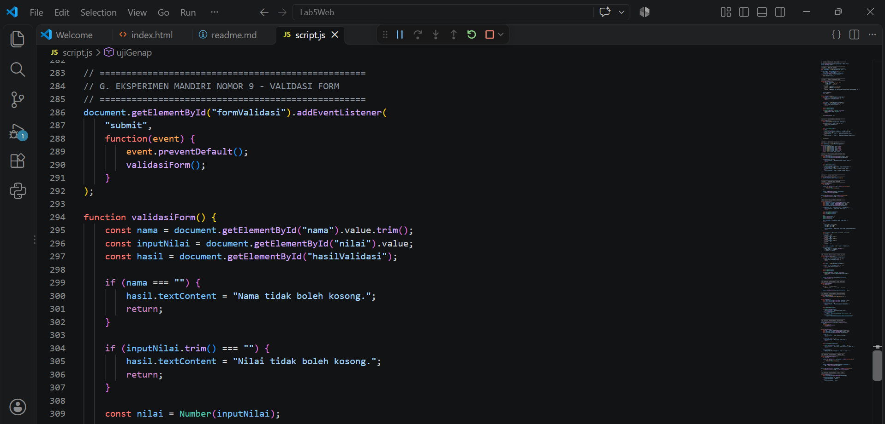
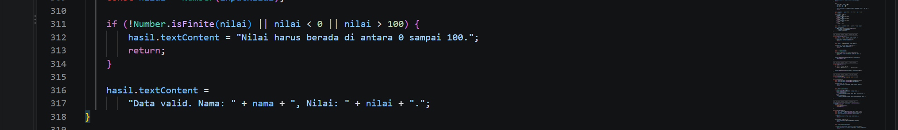
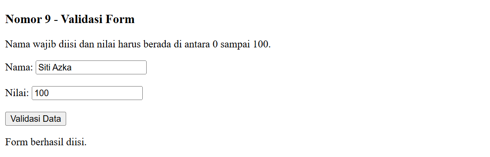

## MENU DAN HARGA

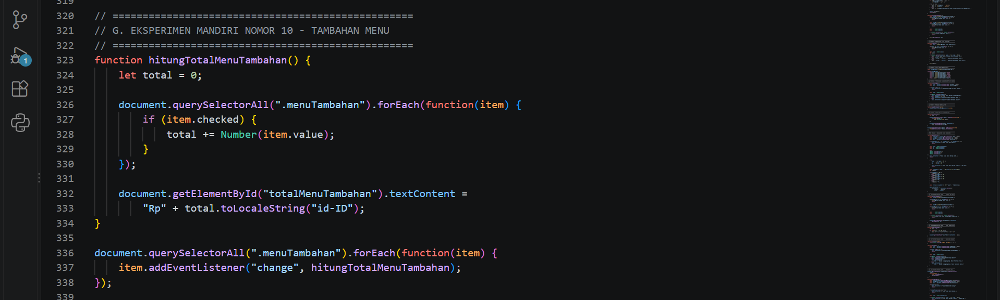
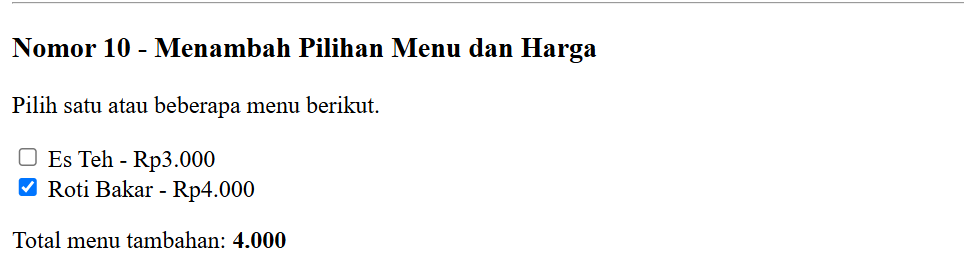

## TAMPILKAN DAN SEMBUNYIKAN ELEMEN HTML

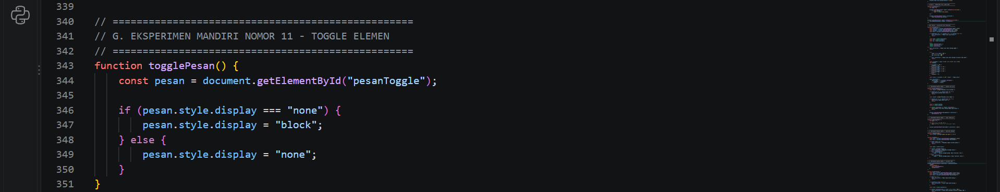
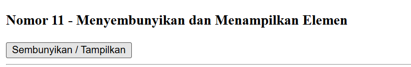
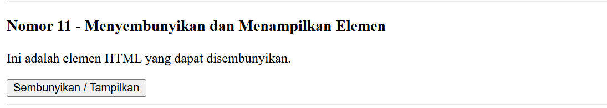